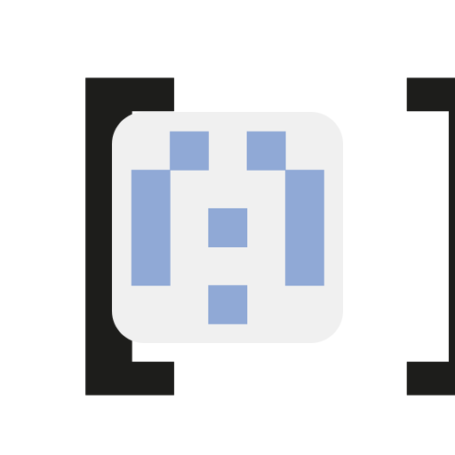

# lezer-shexc-array: lezer-shexc with ShEx- collections

**RDF-** fork of [lezer-shexc](https://github.com/shexjs/lezer-shexc): the grammar gains
the **Collection** shape expression of ShEx-, `((shapeExpr))[min, max]`, which matches a
sequence term of `min` to `max` elements each satisfying `shapeExpr` (`[m]` exactly `m`,
`[m, *]` or `[m,]` at least `m`, no bounds any length). `((x))` is always a Collection, never a
doubly parenthesised `x`; `(x)` stays a parenthesised shape expression. The tree nodes are
`Collection` and `CollectionBounds`.


An incremental, error-tolerant [Lezer](https://lezer.codemirror.net/)
grammar for ShEx Compact Syntax (ShExC), with highlighting tags for
CodeMirror 6.

```js
import {parser} from "lezer-shexc";
const tree = parser.parse(schemaText);   // a @lezer/common Tree
```

The grammar follows the ShExC grammar in the
[ShEx specification](https://shex.io/shex-semantics/#shexc), in the LALR
shape [shex.js's own parser](https://github.com/shexjs/shex.js/blob/main/packages/shex-parser/lib/ShExJison.jison) gives it,
so what parses here is what the validator accepts: every schema in the
ShEx test suite parses without an error node, and a schema the validator
refuses shows where.  Being Lezer, a half-typed schema still parses around
the error, and an edit re-parses only what it touched.

This is the editor's parse -- colour, folding, bracket matching, the
structure under the cursor.  The schema itself still comes from
[`@shexjs/parser`](https://www.npmjs.com/package/@shexjs/parser); [`@shexjs/editor-services`](https://github.com/shexjs/shex.js/tree/main/packages/shex-editor-services#readme) uses both.

`src/parser.js` is generated from `src/shexc.grammar` by `npm run build`
(`@lezer/generator`).

## Development

```sh
git clone https://github.com/shexjs/lezer-shexc.git
cd lezer-shexc
npm install      # also runs `prepare`, i.e. `npm run build`
npm test
```

The tests run the grammar over the [ShEx test suite](https://github.com/shexSpec/shexTest)
(`schemas/` must parse clean, `negativeSyntax/` must not), which `npm install`
fetches as the `shex-test` devDependency.  To test against a checkout instead,
name it: `SHEX_TEST=../shexTest npm test`.

`src/parser.js` and `src/parser.terms.js` are committed so that the package
installs from git without a build step; regenerate them (`npm run build`)
in the same commit as a change to `src/shexc.grammar` -- CI checks that
they match.

Maintained alongside [shex.js](https://github.com/shexjs/shex.js) by the
same people; issues and pull requests about the grammar belong here.
